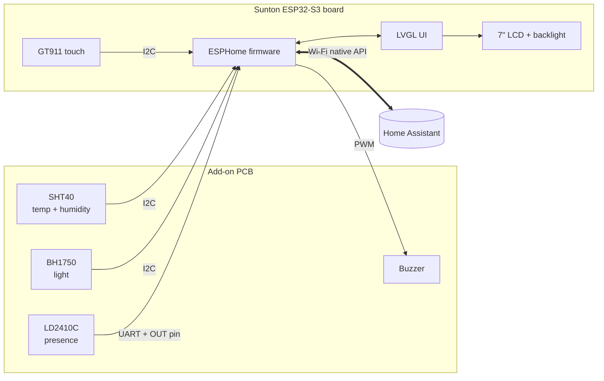
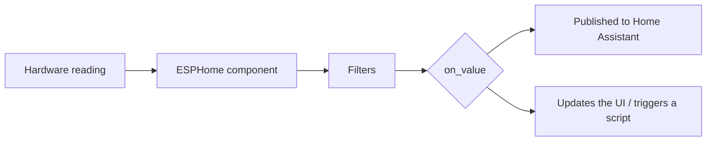
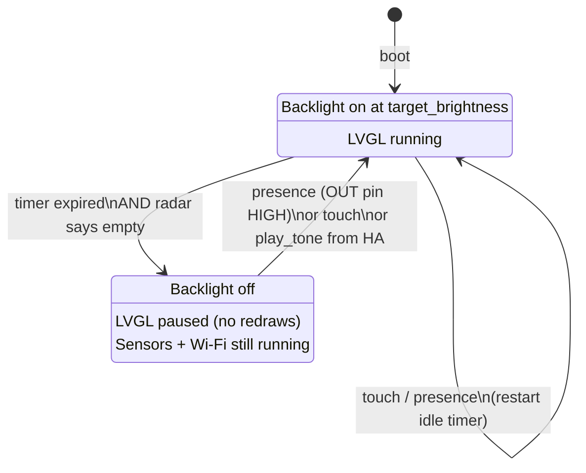
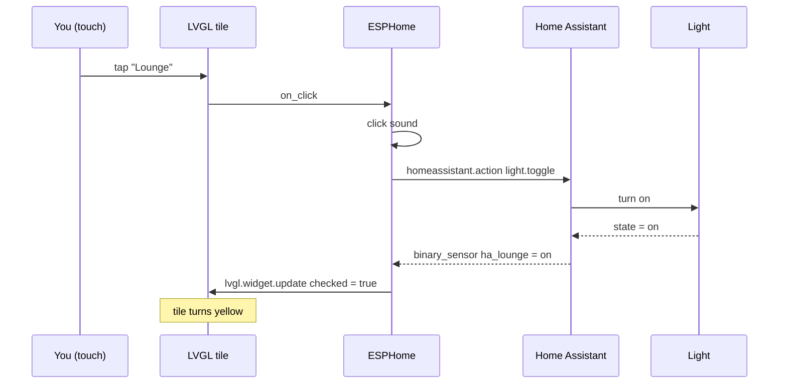

# HomeDeck Firmware Guide

This explains how `homedeck.yaml` works: what each part does, how the sensors are wired up and processed, and how the touchscreen UI talks to Home Assistant.

**Stack:** [ESPHome](https://esphome.io) (YAML firmware for ESP32) + [LVGL](https://lvgl.io) (the graphics library ESPHome uses for touch UIs) + [Home Assistant](https://www.home-assistant.io).

---

## Contents

1. [Overview](#1-overview)
2. [Hardware & pin map](#2-hardware--pin-map)
3. [Sensor integrations](#3-sensor-integrations)
   - [SHT40 – temperature & humidity](#31-sht40--temperature--humidity)
   - [BH1750 – ambient light & auto-brightness](#32-bh1750--ambient-light--auto-brightness)
   - [LD2410C – mmWave presence](#33-ld2410c--mmwave-presence)
   - [Buzzer](#34-buzzer)
4. [Screen sleep / wake logic](#4-screen-sleep--wake-logic)
5. [LVGL UI logic](#5-lvgl-ui-logic)
   - [Layout & navigation](#51-layout--navigation)
   - [Two-way sync with Home Assistant](#52-two-way-sync-with-home-assistant)
   - [Page by page](#53-page-by-page)
6. [Entities HomeDeck adds to Home Assistant](#6-entities-homedeck-adds-to-home-assistant)
7. [Install & flash](#7-install--flash)
8. [Calibration & tuning](#8-calibration--tuning)
9. [Troubleshooting](#9-troubleshooting)

---

## 1. Overview



The firmware does four jobs:

| Job | How |
|---|---|
| **Show** home info | Pulls states from Home Assistant (weather, lights, AC, media) into LVGL widgets |
| **Control** the home | Touching a widget calls a Home Assistant action (`light.toggle`, `climate.set_temperature`…) |
| **Sense** the room | Publishes temperature, humidity, light level and presence back to Home Assistant |
| **Save power / be polite** | Screen wakes when someone walks up, sleeps when they leave, dims in the dark |

---

## 2. Hardware & pin map

| Signal | ESP32 pin | Where | Bus / type |
|---|---|---|---|
| I2C SDA | GPIO19 | Sunton P3 → add-on J3 | I2C (shared) |
| I2C SCL | GPIO20 | Sunton P3 → add-on J3 | I2C (shared) |
| LD2410C RX ← ESP TX | GPIO43 | Sunton P1 → add-on J2 | UART 256000 8N1 |
| LD2410C TX → ESP RX | GPIO44 | Sunton P1 → add-on J2 | UART |
| LD2410C OUT | GPIO17 | Sunton P4 → add-on J4 | Digital input |
| Buzzer | GPIO18 | Sunton P4 → add-on J4 | PWM (LEDC) |
| Backlight | GPIO2 | on Sunton board | PWM (LEDC) |
| Touch reset | GPIO38 | on Sunton board | Digital output |

**I2C bus devices** (no address conflicts):

| Address | Device | Location |
|---|---|---|
| `0x5D` / `0x14` | GT911 touch | Sunton board |
| `0x44` | SHT40 | Add-on PCB, socket J5 |
| `0x23` | BH1750 | Add-on PCB, socket J6 (ADDR → GND) |

> **Why serial logging is off:** GPIO43/44 are UART0, the same pins the USB-serial chip uses. The LD2410C needs them, so `logger: baud_rate: 0`. Logs are still available wirelessly in the ESPHome dashboard. Flash over USB once, then use OTA.

---

## 3. Sensor integrations

Every sensor follows the same path:



### 3.1 SHT40 – temperature & humidity

| | |
|---|---|
| Component | [`sht4x`](https://esphome.io/components/sensor/sht4x.html) |
| Bus | I2C `0x44` |
| Physical location | Back shell, next to the vent slots (see enclosure exploded view) |
| Update interval | 30 s |
| HA entities | `sensor.homedeck_room_temperature`, `sensor.homedeck_room_humidity` |

**Processing:**

1. `precision: High`: the most accurate mode (takes ~9 ms, irrelevant at 30 s intervals).
2. `heater_max_duty: 0`: the SHT40 has a built-in heater for de-fogging. It's turned off because it would raise the temperature reading.
3. `offset: ${sht40_temp_offset}`: even away from the LCD, the inside of the case runs slightly warm. The offset (default −1.5 °C) corrects for it. See [Calibration](#8-calibration--tuning).
4. `sliding_window_moving_average` (4 samples = 2 minutes): smooths small jumps so the number on screen doesn't flicker between e.g. 22.4 and 22.5.

**On the screen:** both temperature and humidity call `update_room_label`, which formats `Room 22.4°C · 48%` on the Home page. It shows `Room --` until the first reading arrives (the value is `NaN` before that).

### 3.2 BH1750 – ambient light & auto-brightness

| | |
|---|---|
| Component | [`bh1750`](https://esphome.io/components/sensor/bh1750.html) |
| Bus | I2C `0x23` |
| Physical location | Behind the small window in the top bezel |
| Update interval | 2 s, averaged over 5 readings (~10 s) |
| HA entity | `sensor.homedeck_room_light` (lux) |

**Auto-brightness formula** (script `auto_brightness`):

```
brightness = clamp( min + lux / lux_full_brightness ,  min ,  1.0 )
```

With the defaults (`min` = 15 %, `lux_full_brightness` = 400):

| Room | Lux | Backlight |
|---|---|---|
| Dark bedroom | 0 | 15 % |
| Evening lamp | 100 | 40 % |
| Normal room | 200 | 65 % |
| Daylight | 400+ | 100 % |

**Design choices:**

- **The 10 s average** stops the backlight "pumping" when someone walks past and casts a shadow.
- **The result is stored in `target_brightness`** and only applied if the screen is on. If the screen is asleep, `wake_screen` uses the stored value later, so the screen always wakes at the right brightness.
- The backlight has a **400 ms fade** (`default_transition_length`), so brightness changes are smooth.
- Auto-brightness can be turned off and the minimum changed from Home Assistant (see [section 6](#6-entities-homedeck-adds-to-home-assistant)).

### 3.3 LD2410C – mmWave presence

| | |
|---|---|
| Component | [`ld2410`](https://esphome.io/components/sensor/ld2410.html) |
| Bus | UART 256000 baud + OUT pin on GPIO17 |
| Physical location | Behind the top bezel (radar works through 2 mm of plastic) |
| HA entities | `binary_sensor.homedeck_presence`, `binary_sensor.homedeck_presence_out_pin`, `sensor.homedeck_presence_distance` |

The LD2410C gives **two** presence signals, and the firmware uses both for different things:

| Signal | Speed | Used for |
|---|---|---|
| **UART** (`has_target`, `detection_distance`) | ~100 ms, needs parsing | Home Assistant automations, graphs |
| **OUT pin** (GPIO17, HIGH = present) | Instant, plain digital | Waking the screen |

Unlike a normal PIR motion sensor, mmWave radar detects **tiny movements like breathing**, so it knows someone is still there while they're sitting still reading the screen.

- `timeout: 5s` on the radar: how long it keeps saying "present" after the last movement.
- `delayed_off: 2s` filter on the OUT pin: ignores very short drop-outs.

### 3.4 Buzzer

| | |
|---|---|
| Component | [`rtttl`](https://esphome.io/components/rtttl.html) on an `ledc` PWM output |
| Pin | GPIO18 → NPN transistor on the add-on PCB → piezo |

- **Button click:** the `click` script plays a 1-note tick. Turn it off with the "Button Sounds" switch in Home Assistant.
- **Alerts:** Home Assistant can call `esphome.homedeck_play_tone` with any RTTTL tune. This also wakes the screen. For example, a doorbell automation:

```yaml
action: esphome.homedeck_play_tone
data:
  song: "ding:d=8,o=6,b=180:e,c"
```

---

## 4. Screen sleep / wake logic



Three scripts implement this:

| Script | Mode | What it does |
|---|---|---|
| `wake_screen` | `restart` | Resumes LVGL if paused, briefly disables the nav bar so the waking tap doesn't press a button, fades the backlight on, restarts `idle_timer` |
| `idle_timer` | `restart` | Waits `screen_timeout` seconds (default 45). Then, **only if the OUT pin is LOW**, turns the backlight off and pauses LVGL |
| `auto_brightness` | `queued` | Recalculates `target_brightness` from lux (see 3.2) |

**Why `mode: restart` matters:** every new touch or presence event calls `idle_timer` again. Restart mode cancels the running countdown and starts a new one, so the screen only sleeps after a full timeout of no activity.

**Why the radar check:** without it, someone reading the screen without touching it would see it switch off after 45 s. Checking the OUT pin first means the screen stays on while anyone is in front of it.

**Why pause LVGL:** redrawing 800 × 480 pixels uses a lot of CPU. Pausing while asleep frees the ESP32 for Wi-Fi and sensors, and `lvgl.resume` redraws instantly on wake.

---

## 5. LVGL UI logic

### 5.1 Layout & navigation

```
┌──────────────────────────────────────────────┐ y=0
│                                              │
│        PAGE  (Home / Rooms / Climate / Media)│
│                                              │
├──────────────────────────────────────────────┤ y=410
│  [Home]    [Rooms]    [Climate]    [Media]   │  ← top_layer nav bar
└──────────────────────────────────────────────┘ y=480
```

- **Pages:** LVGL shows one page at a time, and a nav button calls `lvgl.page.show: page_xxx`.
- **Top layer:** the nav bar is defined once on LVGL's `top_layer`, which is drawn above every page, so it doesn't have to be copied onto each page.
- **Flex layouts:** the nav bar and Room tiles use `layout: flex`, which spaces the buttons automatically instead of hard-coding x/y positions. Changing the number of tiles just means adding or removing one.
- **Styles:** `tile` and `navbtn` in `style_definitions` work like CSS classes, so all buttons share colours and radius from one place.
- **Draw buffer:** `buffer_size: 25%` means LVGL draws the screen in four strips, using a buffer in PSRAM. That's a good balance of speed and memory.

### 5.2 Two-way sync with Home Assistant

Every control on HomeDeck uses the same pattern: **the screen asks, Home Assistant confirms.**



Why the tile waits for Home Assistant instead of changing colour straight away:

- If the light is offline or the action fails, the tile **doesn't lie**: it stays off.
- If someone uses the wall switch or phone app, Home Assistant sends the new state, and the tile **updates by itself**.

The same pattern applies to every control:

| Control | Touch → HA | HA → screen |
|---|---|---|
| Room tiles | `on_click` → `light.toggle` / `fan.toggle` | `homeassistant` binary_sensor → `lvgl.widget.update` (checked) |
| AC dial | `on_release` → `climate.set_temperature` | `ac_setpoint` sensor → `lvgl.arc.update` + label |
| Volume slider | `on_release` → `media_player.volume_set` | `media_volume` sensor → `lvgl.slider.update` |
| Media buttons | `on_click` → `media_previous_track` / `play_pause` / `next_track` | `media_title` text sensor → label |

**`on_release` vs `on_value`:** the dial and slider update their label live while dragging (`on_value`), but only send to Home Assistant once you let go (`on_release`). Otherwise dragging from 20 °C to 25 °C would send 6 separate commands to the air-con.

### 5.3 Page by page

#### Home (read-only dashboard)

| Widget | Shows | Updated by |
|---|---|---|
| `lbl_time` | `14:32` | `interval` every 10 s (after HA time sync) |
| `lbl_date` | `Saturday, 18 October` | same interval |
| `lbl_weather_temp` | `24°` | `outside_temp` (weather entity, `temperature` attribute) |
| `lbl_weather_desc` | `Partly cloudy` | `weather_state`, which converts HA codes like `partlycloudy` into readable text |
| `lbl_room` | `Room 22.4°C · 48%` | `update_room_label` script (SHT40) |

#### Rooms (control)

A 2 × 2 grid of **checkable buttons**. "Checked" = device on, which uses the `checked:` style (yellow for lights, teal for the fan). See 5.2 for the sync logic.

#### Climate (control)

An **arc** (dial) from 16 to 30 °C with the set-point in large text in the middle. Dragging updates the number, and letting go sends `climate.set_temperature`.

#### Media (control)

The track title (long titles are cut off with "…"), prev / play-pause / next buttons using LVGL's built-in symbol icons, and a volume slider (0–100, sent to Home Assistant as 0.0–1.0).

---

## 6. Entities HomeDeck adds to Home Assistant

| Entity | Type | Purpose |
|---|---|---|
| Room Temperature | sensor (°C) | SHT40 |
| Room Humidity | sensor (%) | SHT40 |
| Room Light | sensor (lx) | BH1750 |
| Presence | binary_sensor | LD2410C (UART) |
| Presence (OUT pin) | binary_sensor | LD2410C (fast pin) |
| Presence Distance | sensor (cm) | LD2410C |
| Display Backlight | light | Manual / automation control of the screen |
| Screen Timeout | number (10–600 s) | How long before the screen sleeps |
| Minimum Brightness | number (5–100 %) | Floor for auto-brightness |
| Auto Brightness | switch | Turn auto-brightness on or off |
| Button Sounds | switch | Turn the click sound on or off |
| `esphome.homedeck_play_tone` | action | Play an RTTTL tune (doorbell, timers…) |

The settings (timeout, brightness, switches) use `restore_value` / `RESTORE_DEFAULT_ON`, so they survive reboots.

---

## 7. Install & flash

1. In Home Assistant, install the **ESPHome** add-on (Settings → Add-ons).
2. Create a new device, then replace its YAML with `homedeck.yaml`.
3. Add a `secrets.yaml`:
   ```yaml
   wifi_ssid: "YourWiFi"
   wifi_password: "YourPassword"
   api_key: "generate at esphome.io/components/api"
   ota_password: "anything"
   ```
4. Edit the **substitutions** at the top to match your entity IDs.
5. **First flash over USB-C** (Install → Plug into this computer).
6. Adopt the device in Home Assistant (Settings → Devices → ESPHome).
7. **Important:** on the device page, click **Configure** and tick **"Allow the device to perform Home Assistant actions"**. Without this, the buttons can't control anything.
8. All later updates: **Install → Wirelessly**.

---

## 8. Calibration & tuning

| Setting | Where | How to tune |
|---|---|---|
| `sht40_temp_offset` | substitutions | Put a reference thermometer next to HomeDeck for 1 hour. Offset = reference − HomeDeck reading. |
| `lux_full_brightness` | substitutions | Lower = screen hits 100 % in dimmer rooms. Raise it if the screen is too bright. |
| Minimum Brightness | Home Assistant | Raise it if the screen is hard to read at night. |
| Screen Timeout | Home Assistant | 45 s default. |
| LD2410C sensitivity | HLKRadarTool phone app (Bluetooth) | Set the max detection gate to about 2–3 m so it only reacts to people near the panel, not the whole room. |
| Display timings | `display:` | Only if the image is shifted or flickers (see Troubleshooting). |

---

## 9. Troubleshooting

| Problem | Likely cause | Fix |
|---|---|---|
| Screen garbled or shifted | RGB timing | Try `pclk_inverted: false`, or `pclk_frequency: 12MHz` |
| Buttons do nothing | HA actions not allowed | Step 7 in [Install](#7-install--flash) |
| A tile shows the wrong state | Wrong entity ID | Check `substitutions` against HA |
| `Room --` never changes | SHT40 not found | Check the log for an I2C scan result at `0x44`; check the J5 wiring |
| Brightness never changes | BH1750 not found or switch off | I2C scan for `0x23`; check the "Auto Brightness" switch |
| Screen never sleeps | Radar always sees someone | Lower the LD2410C max gate with HLKRadarTool |
| No serial logs over USB | Expected | Logs are over Wi-Fi only (UART0 is used by the radar) |
| Temperature reads high | Self-heating | Adjust `sht40_temp_offset` |
